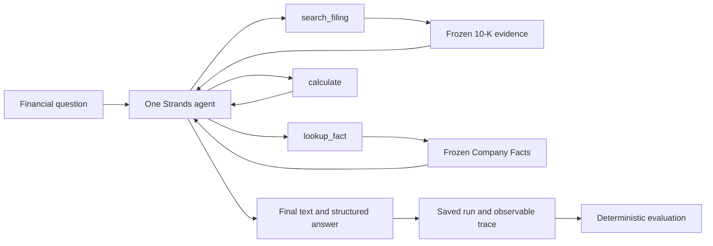
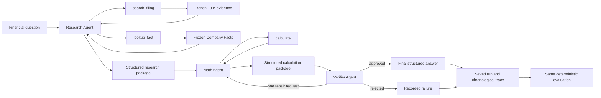

# Auditable SEC Filing Research

An auditable research MVP for answering questions from SEC filings. It compares
a monolithic filing-research agent with a verification-first pipeline against
the same frozen evidence, asking whether clearer process boundaries improve the
audit trail without sacrificing numerical accuracy.

A small two-page web demo (`demo/`) makes the pipeline legible to an audience: a
scripted walkthrough of curated runs and a live chat that answers questions on
demand about the three companies' 10-K filings, with every number shown against
its evidence. It is presentation tooling only — see the
[Presentation demo](#presentation-demo) section below and
[`demo/README.md`](demo/README.md).

## Business problem

A business analyst may need to answer a seemingly simple question before a
meeting: *How did a company's operating income change this year?* Producing a
defensible answer requires more than locating a number. The analyst must find
the right disclosure in a filing that may span hundreds of pages, confirm the
company, fiscal period, unit, and accounting concept, calculate any comparison,
and leave enough evidence for someone else to review the work.

Public financial information is available, but converting it into a reviewable
answer is slow and carries rework risk. A number without a source page cannot be
quickly challenged or confirmed; a result without a recorded formula cannot be
diagnosed when it is wrong. This project therefore treats an answer as a small
audit package: every reported value keeps its source evidence, period, unit, and
calculation record — its “receipt.”

The MVP supports repeatable research on public-company filings, finance
education, internal comparative analysis, and review workflows. It is not a
trading system, does not use private data, does not provide investment advice,
and does not replace professional judgement.

## Research question and scope

> Compared with one tool-using agent, does a verification-first pipeline
> produce better audit trails while keeping similar numerical accuracy?

The controlled experiment uses one frozen fiscal-year 2025 10-K and one SEC
Company Facts file for each of Amazon (`AMZN`), Alphabet (`GOOGL`), and
Coca-Cola (`KO`). It evaluates 48 manually verified questions: 16 development
questions for Amazon, 16 validation questions for Alphabet, and 16 held-out
questions for Coca-Cola. The held-out results are not used to tune prompts,
retrieval, formulas, tools, verification rules, or model settings.

## Repository structure

```text
.
├── data/
│   ├── evaluation/                 # Frozen gold facts and 48 benchmark questions
│   ├── presentation-candidates/    # Curated saved runs for the walkthrough demo
│   ├── raw/                        # Downloaded frozen 10-K and Company Facts inputs (ignored by Git)
│   └── manifest.csv                # Source URLs, filing metadata, and SHA-256 checksums
├── demo/                           # Optional two-page presentation application
│   ├── presentation/               # Replay, labels, timeline, and evaluation adapters
│   └── static/                     # HTML, CSS, and browser JavaScript
├── docs/                           # Retrieval and evaluation design notes
├── notebooks/                      # Reproducible index audit and experiment notebooks
├── results/                        # Saved experiment batches and model-usage totals
├── scripts/                        # Data download, index build, and guardrail commands
├── src/
│   ├── agent/                      # Tools, model providers, traces, and agent orchestration
│   ├── evaluation/                 # Deterministic metrics and optional qualitative review
│   └── retrieval/                  # Filing parsing, chunking, embedding, indexing, and search
├── tests/                          # Deterministic retrieval, integrity, embedding, and guardrail tests
├── .env.example                    # Required local configuration names (never commit secrets)
├── compose.yaml                    # Local Qdrant service
├── pyproject.toml / uv.lock        # Python dependencies and locked environment
└── README.md                       # Project overview and reproduction guide
```

| Location | What it contains | When to use it |
| --- | --- | --- |
| `data/manifest.csv` | The authoritative inventory of frozen inputs and their checksums. | Inspect provenance or validate local files. |
| `data/evaluation/` | Gold facts, question splits, calculation graphs, and evidence requirements. | Understand or reproduce scoring; never feed gold metadata to an agent. |
| `src/` | The application logic, separated by retrieval, orchestration, and evaluation responsibilities. | Read or extend the MVP implementation. |
| `scripts/` | Small command-line entry points for data preparation and infrastructure. | Download frozen data, build the index, or configure guardrails. |
| `notebooks/` | Top-to-bottom experiment and audit runs. | Reproduce development, validation, and held-out comparisons. |
| `results/` | Saved run records and aggregate usage. | Inspect a completed experiment without rerunning a model. |
| `demo/` | Presentation-only walkthrough and live Ask interface. | Demonstrate the system; it is not part of scoring. |
| `docs/` | Detailed engineering rationale for retrieval and evaluation. | Review implementation decisions and metric definitions. |

## Setup

The project requires Python 3.11 or newer and
[uv](https://docs.astral.sh/uv/). Docker is required only for the local Qdrant
retrieval index.

Install the locked Python dependencies and create the local environment file:

```bash
uv sync
cp .env.example .env
```

Run all commands below from the repository root. Project Python commands use
`uv run`.

## SEC data collection

The downloader fetches a filing HTML document and SEC Company Facts JSON for
each selected company. It saves local source metadata in `data/manifest.csv`.

Set the required SEC user agent in `.env`:

```dotenv
SEC_USER_AGENT="Your Name your-email@example.com"
```

Download the project's three default companies for fiscal 2025:

```bash
uv run python scripts/download_data.py
```

Optional inputs are:

- `--companies`: one or more SEC-listed ticker symbols;
- `--year`: one or more requested fiscal/report years;
- `--document-type` (or `--form`): the SEC filing form to download, such as
  `10-K` or `10-Q`.

For example:

```bash
uv run python scripts/download_data.py \
  --companies KO AMZN \
  --year 2025 \
  --document-type 10-Q
```

Downloaded files in `data/raw/` and the cached ticker map are local and ignored
by Git. The manifest records their source URLs and SHA-256 checksums. The
checksum integrity test confirms that local source files match the recorded
frozen inputs; it does not affect retrieval or model behavior.

## Filing chunking and retrieval

The retrieval index is built from the frozen 10-K HTML files listed in
`data/manifest.csv`. It does not call the live SEC API during chunking,
embedding, indexing, or search.

In short, the project verifies each frozen source, preserves its physical pages
and tables, uses `sec-parser` to classify SEC content page by page, creates page
and structured-table evidence, and stores dense plus BM25 representations in
local Qdrant:

```text
Frozen 10-K HTML
    -> checksum verification
    -> physical pages and physical HTML tables
    -> per-page sec-parser semantic classification
    -> page, structured-table, and cross-page-table chunks
    -> dense embeddings and BM25 sparse documents
    -> company-filtered hybrid search in local Qdrant
```

The output contains `filing_page`, `filing_table`, and size-safe
`cross_page_table` evidence. Tables are additional structured evidence; they do
not replace complete page chunks. The detailed algorithm, diagrams, metadata,
validation rules, strategy history, previous-parser problems, and parser
decision are documented in the
[`chunking parser migration guide`](docs/chunking_parser_migration.md).

### Reproduce the local index

Before building, the frozen HTML files must exist in `data/raw/` and match
`data/manifest.csv`. If they are not present, follow the SEC data collection
steps above first.

After deleting an unwanted 10-K HTML file from `data/raw/`, synchronize the
manifest before rebuilding:

```bash
uv run python scripts/download_data.py --sync-manifest
```

This removes stale 10-K rows and verifies the checksums of the files that remain.
Add new filings through the downloader so their SEC metadata is recorded.

Start the local Qdrant container:

```bash
docker compose up -d qdrant
```

Build all chunks, validate their token lengths, create embeddings, and replace
the configured Qdrant collection:

```bash
uv run python scripts/index_filings.py rebuild
```

The rebuild checks source hashes and embedding lengths, recreates only the
configured filing collection, prints a build summary, and validates stored
payloads against a fresh deterministic in-memory chunk build. It does not
modify the frozen source files.

Repeat validation independently:

```bash
uv run python scripts/index_filings.py validate
```

Use `validate` to confirm that the existing Qdrant collection still matches a
fresh build of the chunks from the frozen source files. It checks evidence IDs,
metadata payloads, and token limits without replacing the collection or calling
the SEC.

Search by company ticker and query:

```bash
uv run python scripts/index_filings.py search \
  KO "operating income and operating margin"
```

Use `--limit` to change the number of returned records:

```bash
uv run python scripts/index_filings.py search \
  AMZN "net sales 2024" --limit 3
```

### Inspect the Qdrant database

With the container running, open the local Qdrant dashboard at
<http://localhost:6333/dashboard> and select the `sec_filing_chunks_v1`
collection.

Inspect the collection's vector configuration, point count, and payload indexes:

```bash
curl -s http://localhost:6333/collections/sec_filing_chunks_v1 | jq
```

Inspect one point's audit payload without returning its large vectors:

```bash
curl -s -X POST \
  http://localhost:6333/collections/sec_filing_chunks_v1/points/scroll \
  -H 'Content-Type: application/json' \
  -d '{"limit":1,"with_payload":true,"with_vector":false}' | jq
```

### Inspect and test the implementation

The main files are:

- `src/retrieval/chunking.py`: source validation, HTML parsing, overlap, and
  synthetic table chunks;
- `src/retrieval/embeddings.py`: exact token counting and dense embedding;
- `src/retrieval/`: Qdrant indexing, validation, and hybrid search;
- `src/models.py` and `src/exceptions.py`: shared records and explicit failures;
- `src/agent/`: shared tools plus monolithic and decomposed orchestration;
- `scripts/index_filings.py`: command-line entry point.

The chunk token audit notebook at
[`notebooks/01_chunk_token_audit.ipynb`](notebooks/01_chunk_token_audit.ipynb)
reports chunk sizes, metadata coverage, and—when the local index is
available—retrieval Evidence Recall@5 and Irrelevant Retrieval Rate@5.

Run the focused deterministic checks with:

```bash
uv run pytest tests/test_embeddings.py
```

Search requires a running Qdrant container and a previously built collection.
Checksum mismatch, an oversized filing chunk, unknown company, missing
collection, or unavailable Qdrant produces an explicit error instead of falling
back to live data.

## Evaluation dataset

The completed frozen gold dataset is stored in `data/evaluation/` and documented
in [`data/evaluation/README.md`](data/evaluation/README.md).

It contains 43 verified fact observations and 48 questions split into
company-specific train, validation, and held-out test directories. Every
selected observation is limited to the frozen 10-K accession and cross-checked
against inline XBRL in the corresponding filing.

## Bedrock smoke tests

The smoke test supports Nova Lite, the current Sonnet 4.5 experiment model, and
Haiku 4.5 through the Bedrock Runtime Converse API. Luna uses the Bedrock Mantle
Responses API. Configure an AWS profile with access to the required models,
then add its name and region to `.env`:

```dotenv
AWS_PROFILE="<your-aws-profile>"
AWS_REGION="<your-aws-region>"
```

Authenticate using the method configured for that profile. For example, an AWS
IAM Identity Center profile uses:

```bash
aws sso login --profile <your-aws-profile>
```

An active cached session can be reused until it expires. Run the selected model
check directly with uv:

```bash
uv run python tests/smoke_test_aws_model.py --model nova-lite
uv run python tests/smoke_test_aws_model.py --model sonnet
uv run python tests/smoke_test_aws_model.py --model haiku
uv run python tests/smoke_test_aws_model.py --model luna
```

The smoke test sends one short `2 + 2` request to the selected model and prints
the response and token usage. The default Haiku model ID is a US Bedrock Runtime
inference profile. Luna uses Bedrock Mantle and explicitly sets
`reasoning.effort=none`.

## Amazon Bedrock guardrails

The assistant is limited to factual, read-only SEC filing research. Its Bedrock
guardrail allows filing facts, historical comparisons, and financial
calculations, but blocks personalized buy/sell/hold recommendations, portfolio
allocation advice, and requests to place or automate market orders. The policy
checks both user input and model output, enables prompt-attack filtering, and
evaluates the complete conversation so a restricted request is still blocked
after a long sequence of allowed turns. The project exposes no brokerage or
write tools; this tool boundary is essential because Bedrock guardrails evaluate
text but do not inspect tool arguments or tool results.

Create or update the guardrail and publish an immutable version:

```bash
uv run python scripts/configure_guardrail.py
```

If the provisioning role can create guardrails but cannot list them, create a
new tagged guardrail directly (do this only once to avoid duplicates):

```bash
uv run python scripts/configure_guardrail.py --create-only
```

The provisioner creates the resource with the required
`Project=auditable-sec-filing-research` tag and reconciles that tag on an
existing guardrail. The provisioning identity needs `bedrock:ListGuardrails`,
`bedrock:CreateGuardrail`, `bedrock:UpdateGuardrail`, `bedrock:GetGuardrail`,
`bedrock:TagResource`, and `bedrock:CreateGuardrailVersion`; an organization
service-control policy must also allow these actions. Runtime model calls use the normal Bedrock inference
permissions, while the direct policy tests additionally need
`bedrock:ApplyGuardrail`.

Copy the two printed values into `.env`:

```dotenv
BEDROCK_GUARDRAIL_ID="<printed-guardrail-id>"
BEDROCK_GUARDRAIL_VERSION="<printed-version>"
```

Every project `BedrockModel` then uses the same guardrail with synchronous
stream processing and input/output redaction. Run the local configuration tests
without AWS calls, followed by the opt-in live checks. The live suite tests
allowed SEC research, blocked advice and trade execution, blocked model output,
and a restricted request on conversation turn 10:

```bash
uv run pytest tests/test_guardrails.py -m "not aws_guardrail"
RUN_AWS_GUARDRAIL_INTEGRATION=1 \
  uv run pytest tests/test_guardrails.py -m aws_guardrail -s
```

## Phase 1 monolithic agent

Phase 1 implements the monolithic baseline. One reusable Strands agent receives
each frozen question, uses `search_filing`, `lookup_fact`, and `calculate`, and
returns both human-readable `answer_text` and an auditable structured answer.
The same agent selects evidence, calculates, and writes the answer; all observable
calls and results are saved. Gold data is never included in the prompt, and hidden
reasoning is never stored in the trace.

### Monolithic workflow



### Models used

| Role | Model used | Reasoning |
| --- | --- | --- |
| Monolithic AMZN and GOOGL development runs | Amazon Nova Lite, `amazon.nova-lite-v1:0` | Disabled |
| Optional qualitative evaluation | Claude Haiku 4.5, `us.anthropic.claude-haiku-4-5-20251001-v1:0` | Extended thinking, 1,024-token budget |

### Development finding

Both 16-question Nova Lite batches completed and retrieved complete evidence, but
numerical correctness was 37.50% for both AMZN and GOOGL. The dominant failures
were leaving filing values in millions, using a ratio instead of percentage
growth, choosing the wrong fiscal periods, and omitting values in multi-step
answers. The monolithic trace was useful for diagnosing these mistakes, but the
model was not precise enough for reliable multi-step financial calculations.

```dotenv
AWS_REGION="<your-aws-region>"
AWS_PROFILE="<your-aws-profile>"
BEDROCK_NOVA_LITE_MODEL_ID="amazon.nova-lite-v1:0"
BEDROCK_REASONING_MODE="none"
EVALUATION_JUDGE_MODEL_ID="us.anthropic.claude-haiku-4-5-20251001-v1:0"
EVALUATION_JUDGE_MAX_TOKENS="5000"
EVALUATION_JUDGE_THINKING_BUDGET_TOKENS="1024"
EVALUATION_JUDGE_TIMEOUT_SECONDS="120"
```

Add the three `LANGFUSE_*` credentials shown in `.env.example`. Start Qdrant
and build the filing index as described above. Authenticate the configured AWS
profile, then open and run
[`notebooks/02_monolithic_bedrock_dry_runs.ipynb`](notebooks/02_monolithic_bedrock_dry_runs.ipynb)
from top to bottom.

The notebook performs the external-service preflight, shows observable traces
for four representative AMZN questions, runs and evaluates all 16 AMZN
development questions, then runs the same process for the 16 GOOGL validation
questions. It keeps development and validation outputs separate.

Each attempted inference is appended immediately to the ignored local file
`data/runs/monolithic_bedrock.jsonl`. These JSONL records—not Langfuse—are
the official experiment source. They include observable tool events, evidence
IDs, structured output, failure category, token usage when available, latency,
retry count, cost, and the Langfuse trace link. Hidden chain-of-thought is not
stored.

Each batch is also evaluated by a reusable Haiku 4.5 judge with Bedrock extended
thinking. It assigns 1–5 grades for final-answer correctness, workflow
correctness, chronological coherence, efficiency, and auditability. Deterministic
numerical correctness remains strict and is never overridden by judge grades.

Each saved batch gets its own timestamped `results/` folder containing run JSONL,
judge JSONL, the JSON summary, and per-question/retrieval CSV metrics. Cumulative
per-model tokens and input/output cost are tracked in the committed
`results/model_usage/<model>/usage.json` files.

### Centralized model usage and pricing

All completed model calls made through the project harnesses—including
monolithic, decomposed, evaluation-judge, and smoke-test calls—pass through the
centralized tracker in [`src/model_usage.py`](src/model_usage.py). The tracker
updates a committed `results/model_usage/<model>/usage.json` record with the
model ID, invocation count, input, output, and reasoning tokens, cumulative
input and output cost, total cost, and the latest update time. Token prices are
defined once in [`src/config.py`](src/config.py), and every saved experiment run
records the exact input and output price used by the project for its cost
calculation. This keeps model-call accounting reproducible and makes the
project's currently configured price visible even if provider prices change
later; the configuration comments record when each price was last verified.

The rationale and changes to deterministic and judged metrics are documented in
[`docs/evaluation.md`](docs/evaluation.md).

Run the deterministic checks with:

```bash
uv run pytest
```

OpenRouter remains an optional alternative for users without AWS access. To use
it, pass `provider="openrouter"` and configure its variables in `.env`. Ping
that optional model separately with:

```bash
uv run python tests/smoke_test_openrouter.py
```

The current decomposed experiment is described below. It uses the scoped LLM
Verifier shown in the workflow and is evaluated from its saved observable trace.
Langfuse remains observability support only.

## Decomposed development pipeline

The decomposed development experiment uses a Research Agent with only evidence
tools, a Math Agent with only `calculate`, and a Verifier that cannot call tools
but may request one bounded Math repair. Every attempt remains traceable and only
the accepted attempt is used for formula evaluation.
[`Notebook 03`](notebooks/03_decomposed_bedrock_dry_runs.ipynb) runs this
LLM pipeline for the architecture comparison.

### Decomposed workflow



### Models used

| Role | Model used | Reasoning |
| --- | --- | --- |
| Research, Math, and Verifier in Notebook 03 AMZN and GOOGL runs | Amazon Nova Lite, `amazon.nova-lite-v1:0` | Disabled for all stages |
| Optional qualitative evaluation | Claude Haiku 4.5, `us.anthropic.claude-haiku-4-5-20251001-v1:0` | Extended thinking, 1,024-token budget |

### Development finding

Decomposition made the evidence, calculation, and final-review stages easier to
inspect, but it did not make Nova Lite reliably correct: AMZN achieved 37.50%
numerical correctness and GOOGL 50.00%, while formula correctness was 8.33% for
both. Research handoffs sometimes omitted returned facts, Math reused the same
ratio-versus-growth mistakes, and the LLM verifier sometimes rejected correct
work or approved wrong calculations without requesting repair. This development
experiment improves diagnosis, not yet verified financial reliability.

## Held-out architecture experiment results

[`Notebook 04`](notebooks/04_sonnet45_final_comparison.ipynb) compares four
architecture configurations on the same 16-question Coca-Cola held-out test set.
The table below contains the selected presentation metrics from those recorded
experiments. Estimated cost is the total answer-generation cost for all 16 runs;
LLM-judge cost is separate.

| Metric | Monolithic | Decomposed + Verifier, no thinking | Decomposed without Verifier | Decomposed + Verifier, reasoning |
| --- | ---: | ---: | ---: | ---: |
| Numerical correctness rate | 37.50% | 68.75% | 68.75% | 75.00% |
| Evidence validity rate | 100.00% | 100.00% | 100.00% | 100.00% |
| Formula correctness rate | 58.33% | 66.67% | 75.00% | 58.33% |
| Formatting correctness rate | 87.50% | 87.50% | 87.50% | 87.50% |
| Audit-trail completeness rate | 56.25% | 68.75% | 68.75% | 56.25% |
| Unsupported-number rate | 6.90% | 25.00% | 8.11% | 3.12% |
| Tool F1 | 98.36% | 98.36% | 96.77% | 96.77% |
| Conditional execution rate | 97.92% | 97.92% | 95.83% | 95.83% |
| Average latency | 17,178.55 ms | 29,139.18 ms | 29,441.10 ms | 43,482.96 ms |
| Estimated cost, 16 runs | $1.073958 | $1.585908 | $1.622322 | $1.664871 |
| Judge LLM answer-correctness grade | 4.25/5 | 4.56/5 | 4.81/5 | 4.19/5 |
| Judge chronological-coherence grade | 4.94/5 | 4.94/5 | 4.81/5 | 5.00/5 |
| Judge workflow-efficiency grade | 4.62/5 | 4.62/5 | 3.94/5 | 4.69/5 |

The decomposed approach with a verifier is the best overall choice because it
provides a clearer audit trail showing where each number came from and how it
was calculated, while improving numerical correctness from 37.50% for the
monolithic agent to 68.75%. However, the verifier did not correct any final
answers in this experiment, so the results do not prove that verification
itself caused the improvement on our benchmark. Enabling additional reasoning produced the
highest numerical correctness at 75.00%, but it reduced formula correctness and
audit-trail completeness, increased average latency to 43.48 seconds, cost
more, and received a lower LLM-judge answer grade. Overall, decomposition
improved accuracy and traceability, but the verifier and additional reasoning
did not consistently improve every aspect of performance.

## Presentation demo

A two-page web demo makes the pipeline legible to an audience. It is
presentation tooling only: it never writes run records and never changes how runs
are scored.

```bash
uv sync --group demo
uv run uvicorn demo.server:app --port 8000
```

- `http://localhost:8000/` plays the four curated held-out Coca-Cola runs step by
  step against a pipeline diagram, then shows the verified reference answer, a
  value-by-value comparison, every saved question-level metric, and what the
  deterministic evaluation found wrong.
- `http://localhost:8000/chat` answers questions on demand for any of the three
  companies — name one in the question — showing short phase words while the
  pipeline works and keeping the step-by-step detail in a collapsed audit trail.
  Conversations are multi-turn — follow-ups reuse the conversation's company and
  earlier answers as context — and one question is answered at a time. Three
  recommended questions sit outside the frozen benchmark, and every conversation
  is saved to Amazon Bedrock AgentCore Memory so old chats reopen after a reload.

The demo deliberately shows product names rather than model or pipeline
identifiers, and reports latency in seconds.

The walkthrough works from repository files alone. The Ask page additionally
needs AWS credentials, Langfuse credentials, and Qdrant with the built
collection; `GET /api/health` reports whether it is available. See
[`demo/README.md`](demo/README.md) for details.

## References

The links below document the data, research methods, platforms, and software
used by this project. Exact Python package versions are pinned in
[`pyproject.toml`](pyproject.toml) and [`uv.lock`](uv.lock).

### Primary data and filing standards

- U.S. Securities and Exchange Commission — [EDGAR data APIs and XBRL Company
  Facts documentation](https://www.sec.gov/search-filings/edgar-application-programming-interfaces).
- Amazon.com, Inc. — [2025 Form 10-K](https://www.sec.gov/Archives/edgar/data/1018724/000101872426000004/amzn-20251231.htm) and [Company
  Facts JSON](https://data.sec.gov/api/xbrl/companyfacts/CIK0001018724.json).
- Alphabet Inc. — [2025 Form 10-K](https://www.sec.gov/Archives/edgar/data/1652044/000165204426000018/goog-20251231.htm) and [Company
  Facts JSON](https://data.sec.gov/api/xbrl/companyfacts/CIK0001652044.json).
- The Coca-Cola Company — [2025 Form 10-K](https://www.sec.gov/Archives/edgar/data/21344/000162828026010047/ko-20251231.htm) and [Company
  Facts JSON](https://data.sec.gov/api/xbrl/companyfacts/CIK0000021344.json).

### Financial-agent research and benchmark design

- Lu et al. — [FinToolBench: Evaluating LLM Agents for Real-World Financial Tool
  Use](https://arxiv.org/abs/2603.08262) · [implementation and evaluation
  resources](https://github.com/Double-wk/FinToolBench). It informed the use of
  visible tool traces and tool-execution metrics.
- Zhu et al. — [FinMCP-Bench: Benchmarking LLM Agents for Real-World Financial
  Tool Use under the Model Context Protocol](https://arxiv.org/abs/2603.24943)
  · [dataset](https://huggingface.co/datasets/DianJin/FinMCP-Bench). It
  informed the single-tool, multi-tool, and task-complexity framing.
- Bigeard et al. — [Finance Agent Benchmark: Benchmarking LLMs on Real-world
  Financial Research Tasks](https://arxiv.org/abs/2508.00828) · [benchmark
  harness](https://github.com/vals-ai/finance-agent). It informed the
  SEC-filing research task framing.
- Krumdick et al. — [FrontierFinance: A Long-Horizon Computer-Use Benchmark of
  Real-World Financial Tasks](https://arxiv.org/abs/2604.05912) ·
  [FrontierFinance grader](https://github.com/samaya-ai/frontier-finance). It
  informed detailed reporting across correctness, evidence, efficiency, and
  cost.

### Retrieval and evaluation methods

- Cormack, Clarke, and Buettcher — [Reciprocal Rank Fusion Outperforms
  Condorcet and Individual Rank Learning Methods](https://research.google/pubs/reciprocal-rank-fusion-outperforms-condorcet-and-individual-rank-learning-methods/).
  The project uses RRF to combine dense and BM25 retrieval rankings.
- Qdrant — [hybrid and multi-stage query documentation](https://qdrant.tech/documentation/search/hybrid-queries/) and [FastEmbed hybrid-search
  example](https://qdrant.github.io/fastembed/examples/Hybrid_Search/).

### Model, safety, and observability platforms

- Amazon Web Services — [Amazon Bedrock documentation](https://docs.aws.amazon.com/bedrock/) and [Amazon Bedrock Guardrails
  documentation](https://docs.aws.amazon.com/bedrock/latest/userguide/guardrails.html).
- Anthropic — [Claude documentation](https://docs.anthropic.com/en/docs).
- OpenAI — [API documentation](https://platform.openai.com/docs/overview).
- Strands Agents — [SDK documentation](https://strandsagents.com/latest/).
- Langfuse — [Strands Agents observability integration](https://langfuse.com/integrations/frameworks/strands-agents).
- Amazon Web Services — [Amazon Bedrock AgentCore Memory documentation](https://docs.aws.amazon.com/bedrock-agentcore/latest/devguide/memory-get-started.html).

### Software and development tools

- [Python](https://www.python.org/), [uv](https://docs.astral.sh/uv/), and
  [Docker Compose](https://docs.docker.com/compose/).
- [sec-parser](https://github.com/alphanome-ai/sec-parser),
  [Beautiful Soup](https://www.crummy.com/software/BeautifulSoup/bs4/doc/),
  [Requests](https://requests.readthedocs.io/), and
  [python-dotenv](https://pypi.org/project/python-dotenv/).
- [boto3](https://boto3.amazonaws.com/v1/documentation/api/latest/index.html),
  [Qdrant Python client](https://python-client.qdrant.tech/),
  [FastEmbed](https://qdrant.github.io/fastembed/),
  and [Ragas](https://docs.ragas.io/).
- [JupyterLab](https://jupyterlab.readthedocs.io/),
  [IPython kernel](https://ipykernel.readthedocs.io/),
  [pytest](https://docs.pytest.org/), and [Ruff](https://docs.astral.sh/ruff/).
- [Starlette](https://www.starlette.io/),
  [Uvicorn](https://www.uvicorn.org/), and
  [sse-starlette](https://github.com/sysid/sse-starlette) for the optional demo
  server and progress stream.
